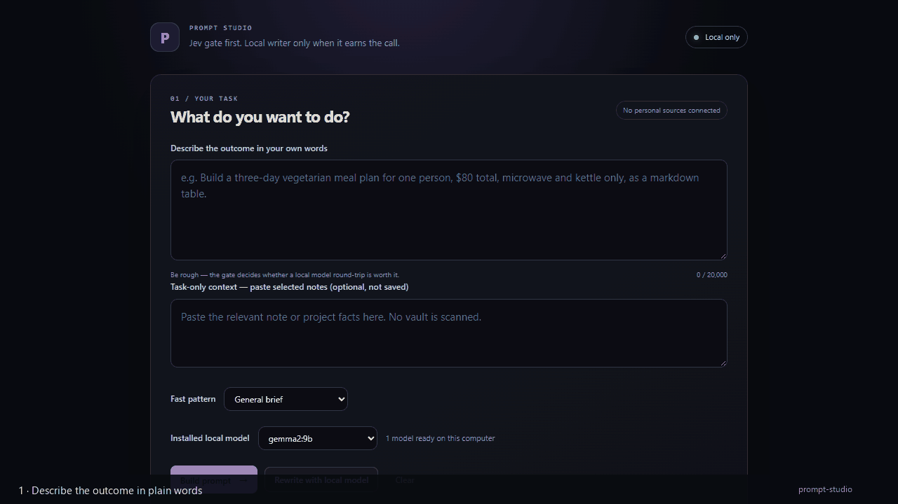
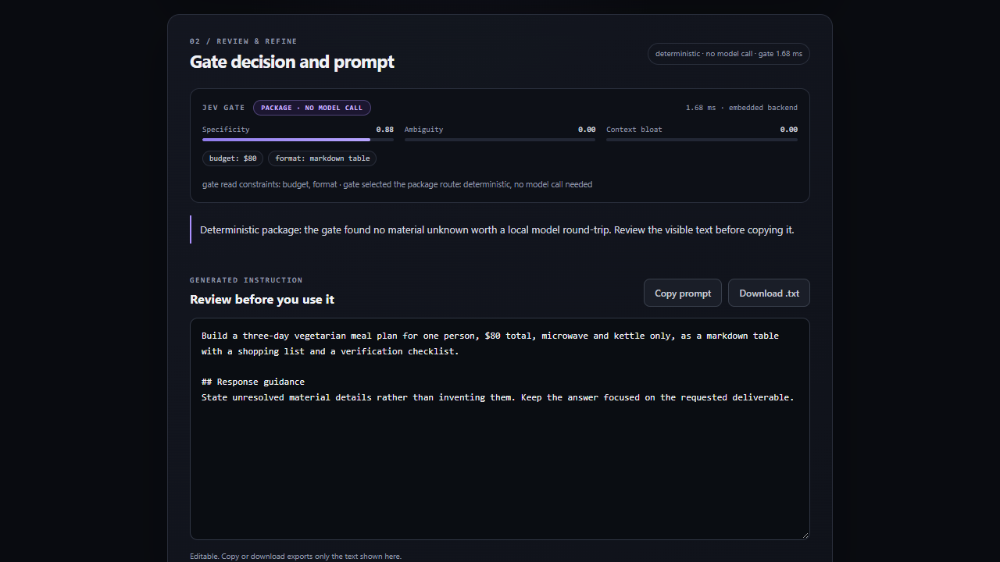

# Prompt Studio

**A local prompt compiler with a Jev System-1 gate.** The gate decides whether a
request needs the local 9B writer at all — then the writer runs entirely on your
machine, behind a loopback-only server.



No cloud provider, no API key, no telemetry. One request in, one reviewable
prompt out.

---

## Why a gate before the prompt

Most prompt "improvers" send every request to a language model. That is the
expensive part, and for a well-specified request it is also unnecessary. Prompt
Studio asks three cheap questions first, using Jev's System-1 contract shape:

| Primitive | Question it answers | Output |
|---|---|---|
| `Score` | How specific is the request? How ambiguous? How bloated is the pasted context? | three bounded `0..1` readings |
| `Choice` | Should this be packaged deterministically, clarified, or drafted? | one route + full score distribution |
| `Noul` | Which typed constraints (budget, deadline, platform, format, audience) are present? | per-field presence reading + source sentence |

The gate returns a route, its probabilities, the extracted constraints, and its
measured latency. Every one of those is shown in the UI before you copy a prompt.

### Routes

- **Package** — the request is specific enough. Build the prompt deterministically,
  with no model call at all.
- **Clarify** — material unknowns remain. The local model may ask up to three
  questions, and only about things that change the deliverable.
- **Draft** — write now and put unresolved unknowns in visible assumptions.

A hard rule outranks the score distribution: `draft-now`, answered clarifications,
and an exhausted clarification budget always finish the prompt rather than loop.

## What this is not

The embedded backend is **deterministic feature scoring, not a trained model**.
Its probabilities are normalized decision scores, and this repository makes no
accuracy or latency claim about a hosted System-1 service. The gate exists to
make routing inspectable and to avoid needless inference — not to pretend a
heuristic is a foundation model.

The writer is whatever Ollama model you already have installed. This is a
single-user local tool, not a hosted product: no auth, no persistence, no
multi-user isolation.

## Quickstart

Requirements: Python 3.10+, [Ollama](https://ollama.com) running locally with at
least one model (`ollama list`).

```bash
# no third-party Python dependencies
python server.py
# Prompt Studio at http://127.0.0.1:4177 (loopback only)
```

Pick your installed model, describe the outcome, and press **Build prompt**.

- **Build prompt** lets the gate choose: package, clarify, or draft.
- **Rewrite with local model** forces the writer, even if the gate would package.

The server binds `127.0.0.1` only, rejects non-loopback `Host` headers and
cross-origin `POST`s, disables redirects and proxies, and never falls back to a
remote provider. The only outbound call it can make is to
`http://127.0.0.1:11434`.

## Tests

```bash
python -m pytest tests -q
```

The suite covers the three primitives, gate routing and hard rules, the
no-model package path, the loopback HTTP boundary, request limits, and parity
between the Python and browser deterministic compilers (skipped if `node` is
absent).

## How it fits together

```
prompt-studio/
├── prompt_studio/
│   ├── jev.py          # Choice / Score / Noul, embedded deterministic backend
│   ├── decisions.py    # the gate: features → route + constraints + latency
│   ├── packaging.py    # deterministic compiler + task-first draft guard
│   ├── provider.py     # loopback-only Ollama adapter
│   ├── workflow.py     # gate → package or write
│   └── models.py       # typed drafts and results
├── web/                # zero-build UI; compiler.js mirrors packaging.py
├── tests/              # 41 tests
└── server.py           # stdlib HTTP server, 127.0.0.1 only
```

The model never receives more than the request, your explicit answers, and the
context you pasted. The final prompt always starts with your own words, so a bad
model suggestion cannot silently replace your constraints.

## Measured on the development machine

- 41 tests pass (`pytest`, 2026-10-19).
- Gate latency: **0.3–1.7 ms** per request (measured, shown in the UI).
- Deterministic package round-trip: **0.09 s** wall time, no model call.
- Local writer: `gemma2:9b` via Ollama took **26–57 s** for the demo request,
  depending on whether the model was already warm.

These are single-machine observations, not a benchmark. The gate is the fast
part; the writer is exactly as slow as your hardware makes it.



## Roadmap

- Optional hosted Jev adapter behind an explicit backend flag (the public payload
  contract was not verified here, so it is deliberately absent).
- Per-constraint highlight in the generated prompt, not just in the gate panel.
- A recorded evaluation of package-vs-write quality on held-out tasks.

## License

MIT — see [LICENSE](LICENSE).
